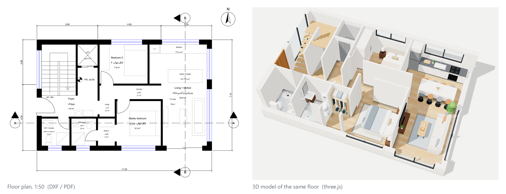
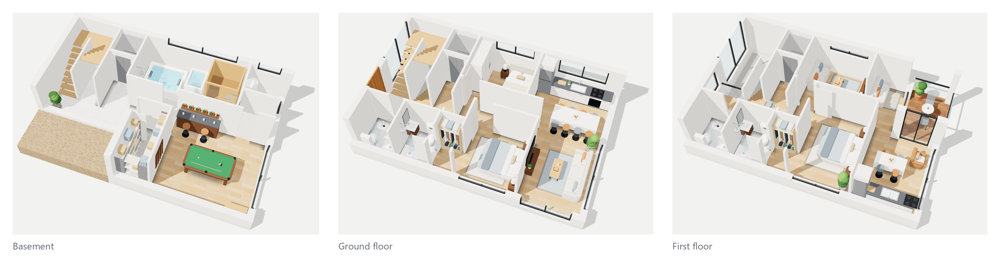
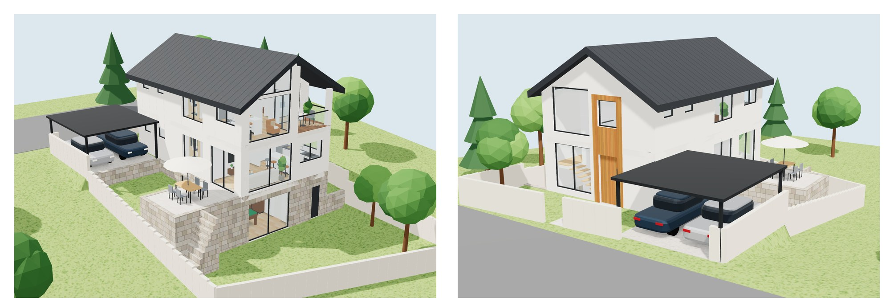
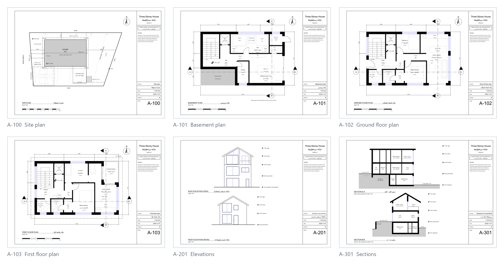
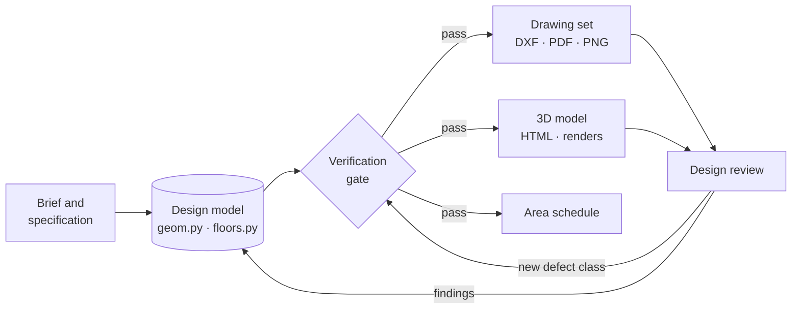
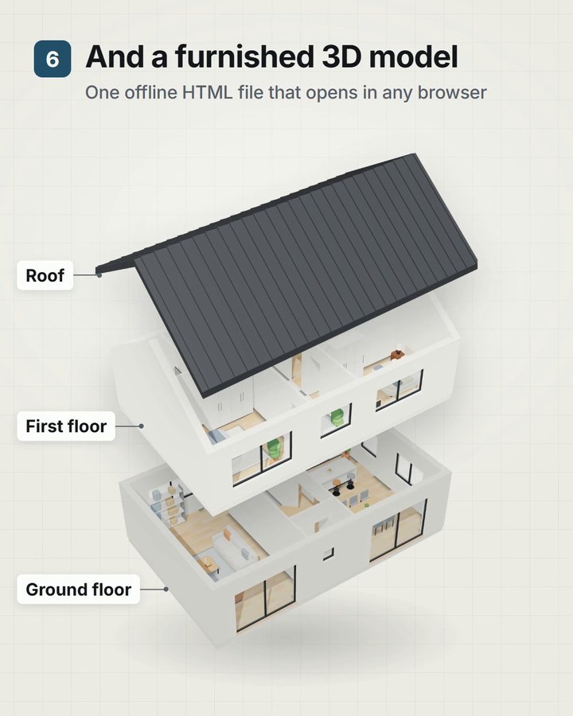

<div align="center">

# Architectural Design Pipeline

**Concept-stage architectural design as code.**<br>
One parametric design model generates a standards-based CAD drawing set, a furnished interactive
3D model and a verified area schedule.

[](https://github.com/Mhrnqaruni/architectural-design-pipeline/actions/workflows/ci.yml)
[](https://mhrnqaruni.github.io/architectural-design-pipeline/)
[](https://github.com/Mhrnqaruni/architectural-design-pipeline/releases)

[](LICENSE)

[**Live 3D model**](https://mhrnqaruni.github.io/architectural-design-pipeline/) ·
[**Drawing set (PDF)**](https://github.com/Mhrnqaruni/architectural-design-pipeline/releases/latest/download/concept-drawings.pdf) ·
[Method](docs/method.md) ·
[Architecture](docs/architecture.md) ·
[Standards](docs/standards.md) ·
[Agent skill and video](#agent-skill)



<sub><b>Figure 1.</b> A generated floor plan (left) and the same floor in the generated 3D model (right). Both
are derived from one design model.</sub>

</div>

## Overview

In conventional concept design, plans live in CAD, the 3D model lives in another tool and the area
schedule lives in a spreadsheet. Every change has to be repeated in each place, and the three drift
apart. This project treats the design as code instead. Two Python modules describe the site, the
envelope and every wall, opening, room, fixture and piece of furniture. Everything else is
generated from them: an A3 drawing set, a true-size CAD model, a furnished WebGL model, renders and
an area schedule. A verification stage enforces the design rules before any output is produced.

The reference project is a house on three levels (basement, ground floor and first floor) on a
sloping site. It goes from a short brief to a concept design package that a licensed engineer can
develop further.

## Highlights

- **Single source of truth.** Geometry and building program are plain Python data. Every drawing,
  the 3D model, the area schedule and the checks read the same model, so they cannot disagree.
- **Standards-based drawing set.** Eight A3 sheets: site plan, floor plans at 1:50, elevations and
  sections at 1:100. Written as DXF R2018 on AIA / US National CAD Standard layers, rendered to PDF
  and PNG, with dimension chains, level markers, section marks, fixture symbols and title blocks.
- **Furnished 3D model in one file.** A custom three.js viewer, inlined into a single offline HTML
  page. It shows cutaway floors, about 75 parametric furniture items, procedural materials and soft
  shadows, and renders only on interaction.
- **Design rules as a build gate.** Circulation reachability, door-swing clearance, area limits and
  area-schedule closure run before every build, and as tests in CI.
- **Reproducible.** Pinned dependencies, seeded procedural textures, deterministic generators, and
  headless rendering that needs no GPU.
- **Lightweight.** No CAD licence, no GPU and no server; the full pipeline runs on a laptop.

## Contents

[Results](#results) · [How it works](#how-it-works) · [Verification](#verification) ·
[Getting started](#getting-started) · [Adapting it](#adapting-it-to-a-new-project) ·
[Project structure](#project-structure) · [Roadmap](#roadmap) · [Limitations](#limitations) ·
[Citation](#citation) · [License](#license)

## Results



<sub><b>Figure 2.</b> Each floor as a furnished cutaway. Walls are cut at 2.4 m; walls facing the camera
drop to 0.6 m so the rooms behind them stay visible.</sub>



<sub><b>Figure 3.</b> Exterior views. Terrain, retaining walls, roof and site elements are generated from
the same model.</sub>



<sub><b>Figure 4.</b> Six of the eight A3 sheets: site plan, floor plans at 1:50, elevations and sections at
1:100.</sub>

| Output | Format | Notes |
|---|---|---|
| Drawing set | DXF R2018, PDF, PNG | 8 A3 sheets on AIA / NCS layers, plus a combined PDF |
| True-size model | DXF, metres | site plan and floor plans for downstream CAD work |
| 3D model | single HTML file | three.js r147 inlined; works offline; cutaway floors and exterior |
| Renders | PNG, 1920 × 1200 | eight views, rendered headlessly |
| Area schedule | cover sheet | rows close exactly on each floor's built area |

## How it works



1. **Requirements.** The brief is broken down into a requirement matrix. Gaps are resolved with
   short decision questions: three options, one recommendation and one reason each.
2. **Standards.** The design-stage scope (RIBA Stage 2 / AIA Schematic Design), local regulations,
   drafting conventions and clearances are set before any design work. Numeric rules become
   constants and tests.
3. **Specification.** A written design specification fixes the site strategy, the levels, every
   space with its rationale, and the open issues.
4. **Design model.** `geom.py` holds the site, levels, envelope, structural grid and vertical
   circulation. `floors.py` holds the walls, openings, rooms, fixtures and furniture for each floor.
   Both are plain data with no CAD state.
5. **Generation.** Drawing generators compose each sheet through a metric-to-paper `Pen`. A scene
   exporter turns the same data into the compact description that the 3D viewer renders.
6. **Verification and review.** The rule checks run before every build, and the build stops on any
   violation. Findings from design review and from walking through the 3D model go back into the
   design model. Each new class of defect becomes an automated check.

The full method is in [docs/method.md](docs/method.md), and the code structure and data schema are in
[docs/architecture.md](docs/architecture.md).

## Verification

| Check | Method | Guarantee |
|---|---|---|
| Circulation | flood fill on a 5 cm grid from the entrance, through doors and openings only | every room is reachable |
| Door swings | sampled swept quarter-discs against furniture, fixtures, wall segments and other swings | no door opens into anything |
| Area limits | built area per floor: the envelope minus undug ground and open terraces | each floor stays within its limit |
| Area schedule | raster accounting on a 1 cm grid | rooms, circulation and walls sum exactly to the built area |
| 3D furniture | loose-item footprints against door swings | furniture never blocks a door |
| CAD validity | every DXF written is re-read in recovery mode and audited with ezdxf | no audit errors and no repairs needed |

During development these checks caught:

- a layout with no route from the entrance to the main living space,
- several door-swing collisions,
- an area overrun of less than 0.1 m².

Each now has a regression test. Walking through the 3D model caught issues that no rule covered yet,
such as a TV area without a wall to mount the TV on and a kitchen without space for a full-height
refrigerator.

## Getting started

Requirements: Python 3.11 or newer. The renders also need Edge, Chrome or Chromium.

```bash
git clone https://github.com/Mhrnqaruni/architectural-design-pipeline.git
cd architectural-design-pipeline
pip install -e ".[dev]"
archdesign all        # checks → drawing set → 3D model → renders, into ./output
pytest
```

| Command | Produces |
|---|---|
| `archdesign check` | the design-rule report |
| `archdesign drawings [A-102 ...]` | `output/drawings/`: DXF, PDF and PNG per sheet, `concept-drawings.pdf`, `model_1to1_metres.dxf` |
| `archdesign model [--renders]` | `output/model/index.html` (opens in any browser) and `output/model/renders/` |
| `archdesign all` | all of the above |
| `archdesign serve [--port 8765]` | a local allow-list server for the outputs |

To run without installing, use `python -m archdesign <command>`. Prebuilt outputs are attached to each
[release](https://github.com/Mhrnqaruni/architectural-design-pipeline/releases).

## Adapting it to a new project

1. Describe the site, levels and envelope in `archdesign/geom.py`.
2. Describe each floor in `archdesign/floors.py`: walls as rectangles; doors, windows and openings
   as typed tuples; rooms with label points; fixtures and furniture.
3. Set the project's limits and rules, such as setbacks and area limits, and express them as tests.
4. Run `archdesign all`. The verification gate reports any unreachable room or blocked door before
   anything is drawn.

The data schema is documented in [docs/architecture.md](docs/architecture.md#the-design-model).

## Project structure

```text
archdesign/
├── geom.py, floors.py          design model: site, levels, envelope, floors
├── checks.py, areas.py         verification: reachability, door swings, area accounting
├── plans.py, elev.py, section.py, site.py, cover.py
├── sheets.py, sheet.py, cad.py drawing generators, A3 sheets, title blocks, CAD layers
├── drawing_set.py              DXF / PDF / PNG output and the true-size model
├── export3d.py                 design model → 3D scene description
├── viewer3d.html, viewer3d.js  three.js viewer (no build step)
├── web_model.py                single-file 3D page and headless renders
├── server.py, cli.py           local allow-list server and command-line interface
└── vendor/three-r147/          three.js (MIT)
docs/                           method, architecture, standards, figures, overview video
tests/                          design rules as tests
tools/make_figures.py           README figures from the generated outputs
```

## Agent skill

The pipeline has been generalised into an agent skill that coding agents can use on any project:
[architectural-concept-design](https://github.com/Mhrnqaruni/ai-agent-skill-architectural-concept-design).
A single JSON design model replaces the per-project Python model; the skill keeps the same
drawing, rule-checking and 3D methods.

<a href="docs/media/overview.mp4"></a>

The skill's 52-second overview video shows one run on its example project. It covers the brief,
the design model, the rule check catching two planted errors, the fix, the A3 drawing set and the
furnished 3D model.

[Watch the video](docs/media/overview.mp4) (MP4, 1080×1350, 12 MB).

<br clear="right">

## Roadmap

- IFC export for BIM workflows
- Daylight and solar-gain analysis per room
- Structural grid and span checks
- Quantity take-off and cost estimate
- Variant generation and comparison against the brief

## Limitations

- The output is a concept-stage design. Structure, foundations, services and full code compliance
  require a licensed engineer.
- The design rules encode one project's brief and local practice. A new project needs its own rules.
- Renders require a Chromium-based browser.
- PDF and PNG export uses PyMuPDF, which is licensed under AGPL-3.0.

## Citation

If this work is useful to you, please cite it. GitHub's "Cite this repository" button reads
[CITATION.cff](CITATION.cff).

```bibtex
@software{gharooni_architectural_design_pipeline_2026,
  author  = {Gharooni, Mehran},
  title   = {Architectural Design Pipeline},
  year    = {2026},
  version = {1.0.0},
  url     = {https://github.com/Mhrnqaruni/architectural-design-pipeline}
}
```

## Acknowledgements

Built on [ezdxf](https://github.com/mozman/ezdxf), [PyMuPDF](https://github.com/pymupdf/PyMuPDF),
[three.js](https://threejs.org), [NumPy](https://numpy.org),
[arabic-reshaper](https://github.com/mpcabd/python-arabic-reshaper) and
[python-bidi](https://github.com/MeirKriheli/python-bidi).

## License

[MIT](LICENSE). three.js is included under its own MIT licence in `archdesign/vendor/three-r147/`.

---

<sub>Mehran Gharooni · [LinkedIn](https://www.linkedin.com/in/mehran-gharooni-7b5591201/) · [GitHub](https://github.com/Mhrnqaruni)</sub>
