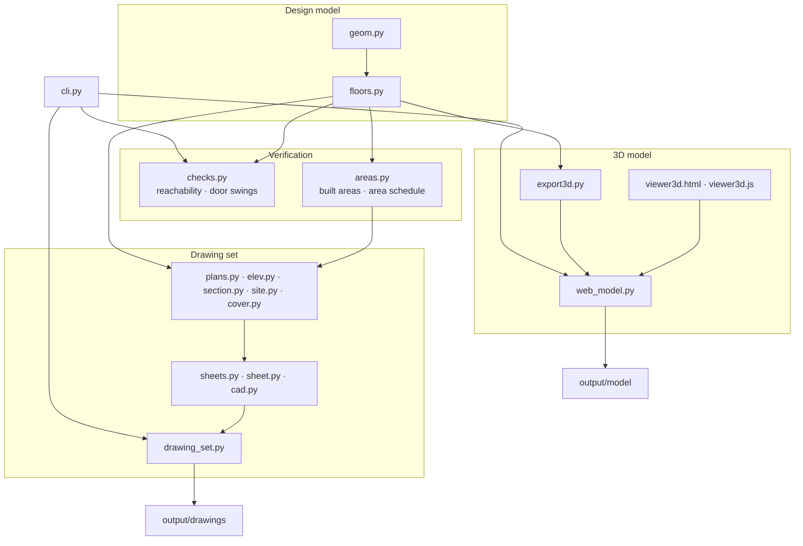

# Architecture

## Conventions

- **Plan coordinates** are metres, with x running east and y running north. Levels (z) are metres
  relative to the road at ±0.00. Rectangles are `(x0, y0, x1, y1)`.
- **Sheets** are drawn in paper millimetres. `cad.Pen` maps plan metres to paper at the sheet scale
  and writes lines, fills, text, arcs and dimensions on AIA/NCS layers.
- **3D** uses three.js axes: Y is up and north is −Z. Plan points convert as
  `P(x, y, z) = (x − cx, z, cy − y)`, centred on the house.

## The design model

`floors.py` describes each floor as a dictionary:

| Key | Format |
|---|---|
| `walls` | partition rectangles 0.10 m thick; outside walls come from the outline or `ext_walls` |
| `openings` | `("door", x0, y0, x1, y1, hinge_at_end, swing)`, `("pivot", …, offset)`, `("slide", …)`, `("window", …, sill, head)`, `("opening", …)` |
| `rooms` | `(name, alt_name, rectangle, label_point)`; `alt_name` is the second-language label, and plan areas come from the rectangle |
| `open_space` | `(name, alt_name, rectangle, cut_outs, label_point)`: one open-plan space, as a rectangle minus cut-outs |
| `furniture` | `bed`, `counter`, `island`, `table`, `sofa`, `tv`, `fridge`, `tub`, `shower`, `basin` as rectangles; `wc` and `squat` as `(x, y, facing)` |

A door with swing `+1` opens towards +y on a horizontal wall, or towards +x on a vertical wall.
Floors share their stacked elements (wet rooms, stair and lift cores) as module-level lists.

## Verification

- `checks.check_reach(name, floor, start)` floods a 5 cm grid from inside the entrance, passing only
  through doors, sliding doors and openings. Every room's label point must be reached. A room that
  is reachable only from outside, such as a plant room with an external door, can be declared as
  an exception.
- `checks.check_swings(name, floor)` samples each door's swept quarter-disc and tests it against
  furniture, fixtures, wall segments and the other swings. It also flags furniture that overlaps
  other furniture or a wall.
- `areas.breakdown(tag)` measures stairs and lift, residual circulation and walls on a 1 cm grid,
  so the area schedule closes exactly on the built area.
- `web_model.check_furniture()` applies the swing test to loose 3D furniture that is not on the
  plans.
- `drawing_set.audit_dxf(path)` re-reads each DXF written in recovery mode and audits it.
  `drawing_set.build` returns every problem found, and the CLI fails if there are any.

`cli.main` runs the checks before any output. The tests in `tests/` assert the same rules, plus the
site survey, setbacks, area limits and kitchen requirements.

## The 3D viewer

`viewer3d.js` is plain JavaScript with no build step.

- **Batching:** geometry is merged into one buffer per group and material, which keeps the number
  of draw calls small.
- **Primitives:** rounded boxes, cylinders and spheres are placed in a local item frame (across,
  depth, height) and rotated by the item's facing direction.
- **Materials:** canvas-drawn wood, tile, stone, concrete, grass and cladding textures. A small
  studio scene is baked once with `PMREMGenerator` and supplies reflections, applied only to glass,
  metal, mirrors and glossy surfaces. ACES tone mapping and sRGB output.
- **Shadows:** a single directional light with PCF soft shadows, plus contact shadows under
  furniture and shading along the foot of each wall.
- **Cutaways:** each outside wall has a high (2.4 m) and a low (0.6 m) group per side. The visible
  group follows the camera azimuth.
- **Rendering:** on demand only. Labels use `CSS2DRenderer` and are hidden when the building
  occludes them.
- **Deep links:** `#house`, `#house-west`, `#first`, `#ground` and `#basement`, with `-nw` for the
  north-west camera, `-nolabels`, or `-still` for clean renders.

## Extending

- **New fixture or furniture type:** add the data in `floors.py`, a plan symbol in `plans.py`, a
  builder in the viewer's `BUILD` table, and a footprint in `checks.fixtures` so swing checking
  covers it.
- **New check:** add a function to `checks.py`, include it in `run_all`, and add a regression test
  that reproduces the defect it guards against.
- **New sheet:** add a drawing function and register it in `sheets.SHEETS`.
