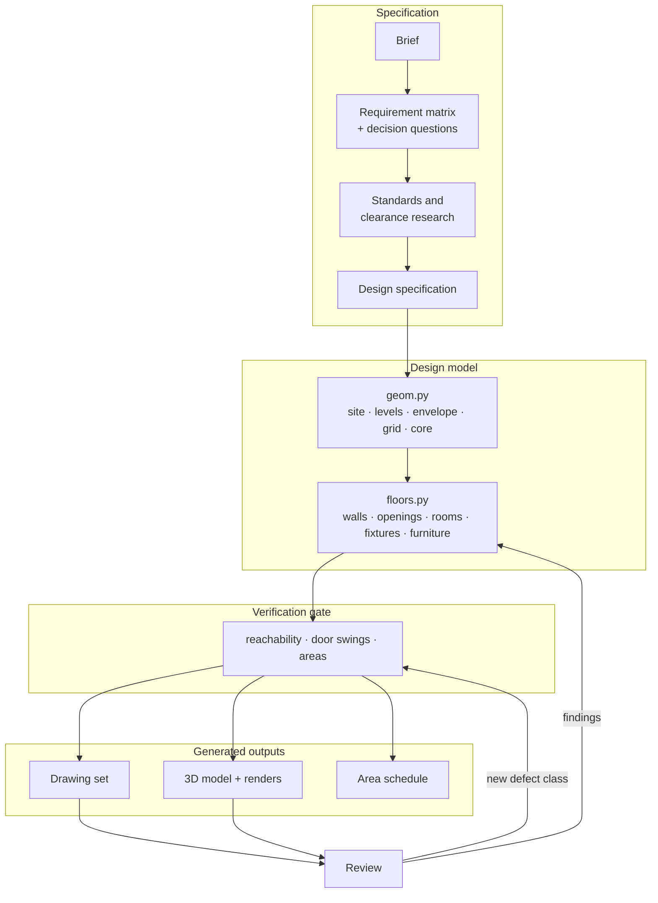

# Method

The pipeline takes a project from a short brief to a concept design package in six stages. Each
stage leaves an artefact that the next one depends on, and the last stage feeds its findings back
into the design model.

## 1. Requirements

The brief is converted into a requirement matrix: spaces per floor, area limits per floor, site
constraints, and preferences such as orientation and adjacency. Anything that would change the
layout but is not stated, such as parking type, stair type, terrace orientation or closet type,
becomes a decision question. Each question has three options, one recommendation and one reason.
Recommendations are researched before they are offered. The answers are recorded next to the
questions, and they fix the inputs to the specification.

## 2. Standards and clearances

Before any layout work, the applicable rules are collected and written down with their sources:

- **Design-stage scope:** RIBA Plan of Work Stage 2 (Concept Design) and the AIA Schematic Design
  phase. Together they define what the package must contain.
- **Local regulations:** general building requirements (room sizes, daylight, ventilation, stairs,
  boundary distances), the seismic design code, and gas-installation rules for the plant room.
- **Clearances:** door widths, door-swing envelopes, corridor and kitchen-aisle widths, stair rise
  and going, and equipment-specific space such as a billiards table with its cue zone.
- **Drafting conventions:** AIA / US National CAD Standard layer names, sheet numbering, scales and
  annotation.

Numeric rules become constants in the design model or assertions in the tests. They are not left in
prose. See [standards.md](standards.md).

## 3. Design specification

A written specification fixes the site strategy, the levels and how the slope is handled, every
space with its size, position and rationale, the façade approach and the open issues. The
drawings follow the specification, and a review round updates both.

## 4. Design model

The specification is transcribed into two modules:

- `geom.py` holds the plot polygon, levels, house envelope, structural grid, stair and lift cores,
  and outdoor areas.
- `floors.py` holds, for each floor, the partition rectangles, typed openings (hinged, pivot and
  sliding doors; windows with sill and head heights), rooms with label points, fixtures and
  furniture.

The model is plain data. Nothing in it knows about paper, CAD entities or WebGL. That separation
keeps every generator thin and lets the checks run without drawing anything.

## 5. Generation

**Drawing set.** A `Pen` maps plan metres to paper millimetres at the sheet scale and writes DXF
entities on AIA/NCS layers. The generators draw:

- filled wall sections, door swings as arcs, sliding and pivot doors, and windows,
- fixture symbols (WC, squat toilet, basin, shower, refrigerator),
- dimension chains, level markers, section marks, north arrows and scale bars,
- title blocks with revision letters.

Each sheet is saved as DXF and rendered to PDF and PNG through the ezdxf drawing add-on. A
true-size model in metres is written for downstream CAD work. Labels in a right-to-left script are
pre-shaped, because CAD text engines don't join those letters themselves.

**3D model.** `export3d.py` turns the same data into a compact scene description:

- wall pieces split around openings, with glazing and frames,
- floor finishes and stair flights,
- parametric furniture with an orientation,
- roof, terrain and site elements.

The viewer (`viewer3d.js`) builds geometry in the browser and merges it into one mesh per group and
material. It draws its textures on canvases at start-up and renders only when the view changes.
Floors are shown as cutaways: each outside wall has a 2.4 m version and a 0.6 m version, and the
viewer chooses between them from the camera direction. The scene, the viewer and three.js are
inlined into one HTML file. A headless Chromium browser with SwiftShader WebGL renders the stills,
so no GPU is needed.

## 6. Verification and review

The verification gate runs before every build. It is detailed in the
[README](../README.md#verification). It covers:

- circulation reachability, by a grid flood fill from the entrance through openings,
- door-swing clearance, by sampled quarter-discs against furniture, fixtures, walls and other swings,
- area limits per floor,
- area-schedule closure, by raster accounting on a 1 cm grid,
- loose 3D furniture against door swings,
- an audit of every DXF written, re-read in recovery mode.

Review has two sources: a design review against the specification, and a walk-through of the
furnished 3D model. A furnished model shows problems that line drawings hide, for example a TV area
without a wall to mount the TV on, or a kitchen whose only free wall is a window. Each finding is
fixed in the design model, never in an output. Each new class of defect gets a check, so it cannot
return:

| Finding | Detected by | Now prevented by |
|---|---|---|
| No route from the entrance to the main living space | 3D walk-through | reachability check + regression test |
| Door swings over beds, sofas and other doors | swing check | swing check in the build gate |
| Floor areas slightly over their limits | area audit | area-limit tests |
| Area schedule not closing on the floor totals | area audit | closure test (rooms + circulation + walls = built area) |
| No space for a full-height refrigerator | 3D walk-through | refrigerator required in the kitchen tests |

## Delivery

Every release publishes the drawing set (PDF and DXF), the true-size model, the single-file 3D model
and the renders as assets. The 3D model is also deployed to GitHub Pages by CI. For a private
preview, `archdesign serve` exposes only the generated model, renders and drawing set, which is
suitable for putting behind a temporary tunnel.
